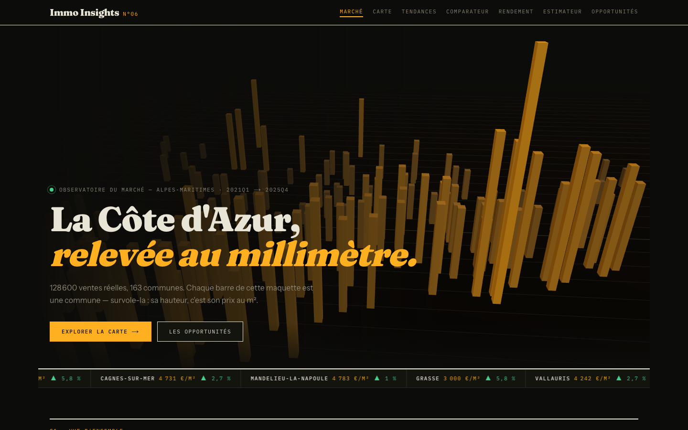
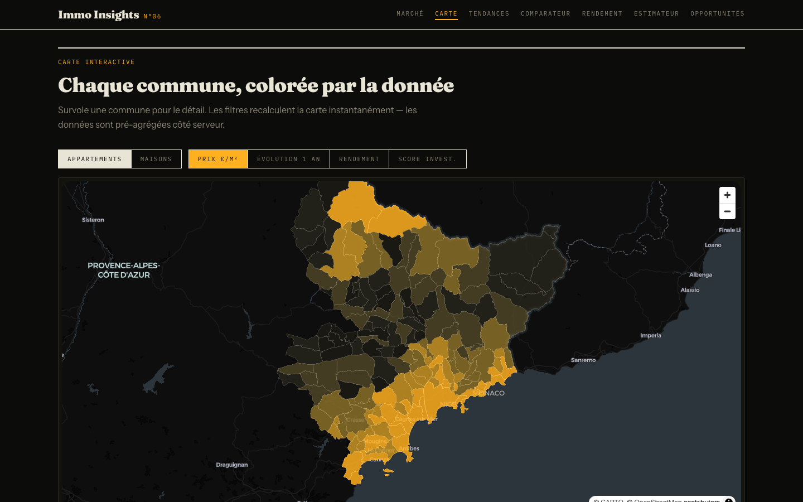
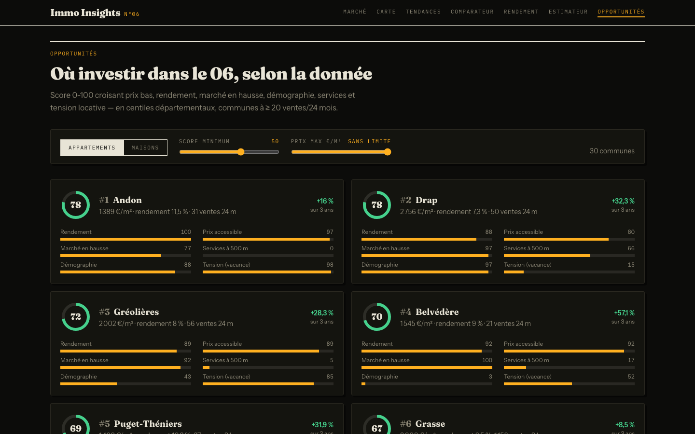

# 🏠 Immo Insights N°06

**Plateforme d'analyse du marché immobilier des Alpes-Maritimes** — de la donnée publique brute au
dashboard 3D interactif, avec un pipeline data industriel au milieu.

**🌐 Démo : [immo-insights-06.vercel.app](https://immo-insights-06.vercel.app)** ·
**API (instantané de juillet 2026) : [fahedza-immo-insights-api.hf.space/docs](https://fahedza-immo-insights-api.hf.space/docs)**


[](https://github.com/fahdzakaria/immo-insights-06/actions/workflows/ci.yml)




## Ce que fait le projet

**128 600 ventes immobilières réelles** (DVF 2021-2025) nettoyées, géocodées et croisées avec
l'INSEE (revenus, démographie), les DPE de l'ADEME, la carte officielle des loyers et les points
d'intérêt OpenStreetMap — puis servies en marts pré-agrégés à un site d'exploration :
prix au m², tendances trimestrielles, rendement locatif, impact de l'étiquette énergétique sur
les prix, estimateur de bien et score d'investissement par commune.

## Architecture

```
      SOURCES PUBLIQUES                DATA LAKE (Parquet, médaillon)            SERVING
┌────────────────────────┐   ┌───────────────────────────────────────────┐   ┌──────────────────┐
│ DVF géolocalisé (Etalab)│   │ BRONZE   brut, immuable, idempotent       │   │ Export JSON des  │
│ INSEE comparateur       │──►│          + politique de fraîcheur/source  │──►│ marts → embarqués│
│ DPE ADEME (API)         │   │ SILVER   9 règles de nettoyage, géocodage │   │ dans le site     │
│ Carte des loyers        │   │          BAN, enrichissement spatial KDTree│  └────────┬─────────┘
│ OSM Overpass            │   │ GOLD     5 marts dbt (parquet + DuckDB)   │            ▼
└────────────────────────┘   └───────────────────────────────────────────┘   Next.js 15 + R3F
                                    ▲                                          (Vercel)
                Airflow (quotidien 06:00, retries, alertes Telegram)    En local : FastAPI +
                dbt run + 38 tests qualité bloquants                    DuckDB in-memory
```

- **Orchestration** : un DAG Airflow `bronze (5 sources //) → silver → dbt run → dbt test → dbt docs + export JSON du site`,
  dépendances fines par source, `max_active_runs=1` (un seul écrivain DuckDB).
- **Déploiement** : les marts gold ne pèsent que **152 Ko** → exportés en JSON en fin de DAG et
  embarqués dans le site (Vercel), qui rejoue la logique de l'API dans le navigateur. Zéro
  serveur à héberger ; l'API FastAPI reste servie par le stack Docker local. Équivalence
  vérifiée sur 1 813 requêtes ([docs/deploiement.md](docs/deploiement.md)).

## Choix techniques (et pourquoi)

| Choix | Justification |
| --- | --- |
| **Parquet médaillon** plutôt qu'une base classique | bronze immuable et rejouable ; les règles de nettoyage peuvent changer sans re-télécharger ; lineage limpide |
| **Idempotence par manifestes + TTL de fraîcheur** | les sources publiques changent sous des URLs stables — sans TTL le bronze resterait figé (DPE/OSM : 7 j, DVF : 15 j, INSEE/loyers : 30 j) |
| **DuckDB** plutôt que Postgres | analytique local ultra-rapide, zéro service à administrer ; l'API lit les Parquet via des vues in-memory → **aucun conflit de verrou** avec le pipeline qui écrit |
| **dbt pour le gold uniquement** | le procédural (géocodage BAN, KDTree spatial) reste en Python testé ; la modélisation SQL déclarative + tests + docs va à dbt |
| **Rapprochement DPE↔vente géographique** | DVF n'a pas d'identifiant de logement : match par position (<50 m) + type + surface ±10 % + DPE antérieur à la vente ; couverture 48 %, rapprochements ambigus (même immeuble, étiquettes différentes) exclus des analyses |
| **Marts pré-agrégés + WHERE en base + cache TTL** | aucun endpoint ne scanne les 128 600 ventes ; réponses en 3-45 ms ; le client ne reçoit jamais plus de 500 lignes |
| **3D InstancedMesh + raycasting manuel** | ~160 barres = 1 draw call ; survol interactif fiable ; three.js chargé uniquement sur la landing |

## Le site — 7 vues

| | |
| --- | --- |
|  |  |

1. **Marché** — maquette 3D interactive (1 barre = 1 commune, survol = prix), ticker de cotations, KPIs animés
2. **Carte** — choroplèthe MapLibre des 163 communes, 4 métriques commutables instantanément
3. **Tendances** — 20 trimestres de prix et volumes, zoom par commune
4. **Comparateur** — 3 communes face à face + radar des 6 composantes du score
5. **Rendement** — nuage prix/rendement + classement filtrable
6. **Estimateur** — méthode transparente : médiane locale 24 mois × écart DPE départemental (appliqué seulement s'il est statistiquement fiable), refus sous 5 ventes
7. **Opportunités** — score d'investissement 0-100 (6 composantes pondérées, centiles départementaux)

Design « terminal éditorial » : charbon, ambre, Fraunces/Plex Mono, animations Framer Motion —
la 3D et les animations ne pénalisent jamais la donnée (bundles par route : 149-256 Ko).

## Qualité des données

- **9 règles de nettoyage documentées** ([docs/silver.md](docs/silver.md)) : 458 841 lignes DVF → 128 600 ventes fiables, entonnoir tracé dans les manifestes
- **38 tests dbt** (unicité, bornes métier, cohérence quartiles, valeurs acceptées) — **bloquants** dans le DAG
- **87 tests pytest** hors-ligne (ingestion, règles silver, API, intégrité du DAG)
- **Intégration continue** (GitHub Actions) : pytest dans l'image Airflow du projet, validation dbt, typage et compilation du site à chaque push
- **Garde-fous statistiques** : rendement calculé à ≥ 5 ventes/24 mois, score à ≥ 20 ventes — les tests ont réellement attrapé un village à 1 vente donnant 45 % de rendement fictif
- **Fiabilité affichée, pas cachée** : fourchette de rendement et drapeau « loyer mesuré localement », intervalle de confiance sur l'écart DPE, niveau de fiabilité de chaque estimation ([docs/gold.md](docs/gold.md))

## Lancer en local

Prérequis : Docker Desktop.

```bash
git clone <repo> && cd immo-data-platform
docker compose up -d          # tout le stack en une commande
```

| Service | URL | Identifiants |
| --- | --- | --- |
| Site | http://localhost:3000 | — |
| API (Swagger) | http://localhost:8001/docs | — |
| Airflow | http://localhost:8081 | admin / admin |

Premier remplissage des données : déclencher le DAG (`immo_pipeline` ▶ dans l'UI Airflow, ou
`docker compose exec airflow-scheduler airflow dags trigger immo_pipeline`) — ~10 min au premier
run (téléchargements), ~15 s ensuite (idempotence). Il tourne ensuite seul chaque matin à 06:00.

```bash
# Tests
docker compose exec airflow-scheduler bash -c "cd /opt/airflow && python -m pytest tests/ -v"
docker compose exec airflow-scheduler bash -c "cd /opt/airflow/dbt/immo && dbt build --profiles-dir ."
```

## Structure

```
├── docker-compose.yml        # 5 services, une commande
├── airflow/dags/             # DAG immo_pipeline (14 tâches)
├── pipelines/
│   ├── ingestion/            # 1 module par source, idempotent + TTL fraîcheur
│   └── silver/               # nettoyage, géocodage BAN (cache), enrichissement KDTree
├── dbt/immo/                 # staging → intermediate → 5 marts + 38 tests
├── api/                      # FastAPI, 10 endpoints filtrables + Dockerfile.deploy
├── frontend/                 # Next.js 15, R3F, MapLibre, Recharts, Framer Motion
├── scripts/deploy_api_hf.sh  # déploiement de l'API sur un hébergeur Docker
├── tests/                    # 87 tests pytest
└── docs/                     # une doc par couche + déploiement
```

Documentation détaillée : [ingestion](docs/ingestion.md) · [silver](docs/silver.md) ·
[gold/dbt](docs/gold.md) · [orchestration](docs/orchestration.md) · [API](docs/api.md) ·
[frontend](docs/frontend.md) · [déploiement](docs/deploiement.md)

## Ce que ce projet démontre

- **Data engineering** : pipeline médaillon idempotent et rejouable, orchestration Airflow avec
  vraie gestion d'échec, modélisation dbt testée, politique de fraîcheur des sources réfléchie
- **Rigueur** : chaque chiffre est traçable (manifestes, entonnoirs, docs par couche), les tests
  qualité ont attrapé de vrais problèmes de données
- **Produit** : une API pensée pour le front (pré-agrégation, filtres en base, cache) et un site
  qui rend 128 600 ventes explorables en quelques millisecondes, design soigné inclus
- **Pragmatisme** : DuckDB embarqué plutôt qu'un cluster, gold de 152 Ko embarqué dans le site
  plutôt qu'une base ou une API hébergée — la solution la plus simple qui marche

## Licence

MIT — données sources : licences ouvertes Etalab / INSEE / ADEME / ODbL (OSM).
